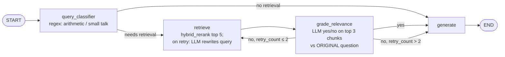

# hybrid-rag-arxiv

Retrieval-augmented question answering over 999 arXiv cs.CL papers about RAG. It combines dense + BM25 hybrid retrieval, a cross-encoder reranker and a local LLM (qwen2.5:7b via Ollama).
The repo also has a LangGraph variant with a grade → rewrite → re-retrieve loop, and a small embedding/tokenizer study. Each one is evaluated with word-overlap metrics on a synthetic QA set.

## Architecture

### Main pipeline

```
arXiv PDFs ──parse──► text ──chunk (512 tok, 50 overlap)──► 28,711 fixed-size chunks
                                                              │
                         ┌────────────────────────────────────┴───────────────┐
                         ▼                                                    ▼
          bge-base-en-v1.5 embeddings                                  BM25 (rank_bm25)
          Qdrant collection `rag_fixed`                                regex tokenizer
                         │ top 50                                             │ top 50
                         └──────────────► Reciprocal Rank Fusion (k=60) ◄─────┘
                                                   │ top 50
                                                   ▼
                              cross-encoder/ms-marco-MiniLM-L-6-v2 rerank
                                                   │ top 5 (800 chars each)
                                                   ▼
                               qwen2.5:7b via Ollama (temperature 0.1) → cited answer
```

A second, semantic chunking (paragraph-based, 19,633 chunks) also exists in the repo. It was embedded and indexed as the Qdrant collection `rag_semantic`, but none of the reported results use it.

### LangGraph loop (`src/agentic_graph.py`)



- A query gets at most 3 retrievals (the first one plus 2 rewrites).
- The grader, the rewriter and the generator all use qwen2.5:7b. The grader and rewriter run at temperature 0.
- `generate` has three context modes (`select_chunks`):
  - `last`: use the final attempt's chunks.
  - `best`: use the attempt whose chunks have the highest mean cross-encoder score against the original question.
  - `merge`: take the union of all attempts' chunks, remove duplicates by `chunk_id`, rerank them against the original question and keep the top 5.

## Results

**Metrics.** These are defined in `src/evaluate.py`. All three are word-overlap metrics, not semantic judgements. Text is lowercased, split on non-alphanumerics, and stopwords and tokens of ≤2 characters are dropped.

- **Context recall:** the fraction of distinct ground-truth terms that appear in the retrieved chunks.
- **Answer F1:** token-level F1 between the generated answer and the ground truth.
- **Faithfulness:** the fraction of distinct answer terms that appear in the retrieved chunks.

### Retrieval strategies (30 questions)

This is a seeded sample (`random.sample`, seed 42) of 30 questions from the 88-question set, using top 5 chunks. Source: `src/eval/comparison_table.csv`.

| Strategy | Context recall | Faithfulness | Answer F1 |
|---|---|---|---|
| dense only | 0.7537 | 0.7849 | 0.3033 |
| hybrid (dense + BM25, RRF) | 0.8220 | 0.8089 | 0.3278 |
| hybrid + rerank | 0.8509 | 0.8127 | 0.3645 |

Compared with dense only, hybrid + rerank had:
- **context recall +12.9% relative** (+0.097 absolute)
- **answer F1 +20.2% relative** (+0.061 absolute)

These come from one run on 30 questions, with no confidence intervals.

### LangGraph context selection (88 questions)

All 88 questions, top 5 chunks. Sources: `src/eval/agentic*/summary.md` and `src/eval/agentic_comparison.md`.

The grader behaved identically in all three runs. Retrieval looped on **31/88 queries (35.2%)**: 5 were accepted after one rewrite and 26 reached the retry limit.

| Pipeline (all 88) | Context recall | Answer F1 | Gold-chunk hit@5 |
|---|---|---|---|
| single-pass hybrid + rerank (baseline) | 0.848 | 0.359–0.364 (varies by run) | 0.76 |
| agentic, `last` (replace with the rewritten retrieval) | 0.817 | 0.328 | 0.68 |
| agentic, `best` | 0.848 | 0.366 | 0.76 |
| agentic, `merge` | 0.858 | 0.371 | 0.77 |

- **Using the last rewritten retrieval made results worse.** On the 31 looped queries, gold-chunk hit fell from 0.61 to 0.39, recall from 0.786 to 0.696, and F1 from 0.319 to 0.231.
- **Merge gave a small recall gain:** 0.848 → 0.858 overall. On looped queries, recall improved for 5/31 and got worse for none.
  - Part of this comes from the design: the merged pool always contains the first-pass chunks.
- **The F1 gain from merge is within noise.** Baseline F1 varies between 0.359 and 0.364 across runs because generation is unseeded. Within the merge run, F1 went from 0.3625 to 0.3714, a gain of +0.009. On looped queries, F1 improved for 12 and got worse for 9.

### Embedding / tokenizer study (`exp_embed_tok/`)

The plan was written before any experiment ran: [`exp_embed_tok/PROTOCOL.md`](exp_embed_tok/PROTOCOL.md). The results are in [`exp_embed_tok/SUMMARY.md`](exp_embed_tok/SUMMARY.md), with raw numbers in `exp_embed_tok/results.json`.

The study used all 88 questions. Values are means with bootstrap 95% CIs (1000 resamples, seed 42).

- **Embedding models.** The study compared bge-base-en-v1.5, all-MiniLM-L6-v2 and e5-base-v2, each in dense-only and full (hybrid + rerank) pipelines.
  - No model showed a statistically significant improvement over bge-base.
  - MiniLM's mean recall in the full pipeline was higher by 0.0145, but its CI [-0.0058, +0.0426] includes zero.
  - The only significant embedding difference was negative: e5 did worse than bge on dense MRR@5, by -0.0820 [-0.1561, -0.0042].
- **End to end** (current bge system vs MiniLM, full pipeline, qwen2.5:7b): answer F1 was 0.363 vs 0.375. The difference is +0.011, CI [-0.010, +0.034]. **This is a null result.**
- **BM25 tokenization.** Porter stemming did not help. It made exact-chunk hit@5 worse than the plain regex tokenizer, by -0.068 [-0.136, -0.011]. WordPiece tokenization showed no significant difference.
- **Truncation.** With the bge prefix added, 56.4% of chunks (16,193 of 28,711) exceed bge's 512-token limit and are truncated when embedded. Without the prefix the figure is 41.5%.
  - Chunks were sized with tiktoken `cl100k_base`, but the embedder uses BERT WordPiece, which produces more tokens for the same text.

## Limitations

- **Synthetic QA set.** Each of the 88 questions was generated by qwen2.5:7b from a single chunk (`src/build_qa_set.py`). That favours retrieving that exact chunk and doesn't test multi-hop questions.
- **Word-overlap metrics.** Context recall, answer F1 and faithfulness count shared terms. They don't measure correctness or meaning.
- **Small n.** The strategy comparison uses 30 questions without CIs. The other evaluations use 88. Most differences reported here have confidence intervals that include zero.
- **Unseeded generation.** Ollama generation isn't seeded (temperature 0.1), so answer F1 varies between runs: the baseline was 0.359–0.364 on the same questions.
- **Imperfect reproducibility.** Re-embedding with bge didn't exactly reproduce the original `rag_fixed` index. The top-5 lists matched for only 80/88 questions (dense) and 79/88 (full pipeline). I didn't investigate the cause.
- **Unusual embedding prefix.** `src/embed.py` adds bge's *query* instruction ("Represent this sentence for searching relevant passages: ") to passages as well as queries. bge without this prefix wasn't tested.
- **A rebuild won't give the same corpus.** `scrape_arxiv.py` fetches the *newest* matching papers, so running it later gives a different set of 999 papers. The original paper list (arXiv IDs, titles, abstracts) is tracked in `src/data/metadata.json`. The script resumes from that file and skips IDs it already has, but it doesn't download the PDFs for those IDs.
- **`app.py` may crash on the "Dense only" strategy.** Dense results are built from the Qdrant payload, which has no `total_chunks` field, and the app reads that field. I found this by reading the code; it hasn't been run or confirmed.
- **Some docstrings are out of date.** `src/generator.py` says it uses the Anthropic API, but the code calls Ollama `qwen2.5:7b`. The "Run: python 0X_….py" lines in several scripts name files that don't exist; use the commands below.

## Setup and run

**Hardware used:** an NVIDIA GeForce RTX 3050 (8 GB), with Python 3.12.3 and torch 2.5.1+cu121. `embed.py`, `retreiver.py` and `app.py` load models with `device="cuda"`, so you need a CUDA GPU.

**Services:**
- **Qdrant** on `localhost:6333`. Start it with the command from `src/index_qudrant.py`, run from the repo root:
  ```bash
  docker run -d -p 6333:6333 -v $(pwd)/qdrant_storage:/qdrant/storage qdrant/qdrant
  ```
- **Ollama** on `localhost:11434`, with the model pulled:
  ```bash
  ollama pull qwen2.5:7b
  ollama serve
  ```

**Python environment:**
```bash
python3 -m venv venv
source venv/bin/activate
pip install torch==2.5.1 --index-url https://download.pytorch.org/whl/cu121
pip install -r requirements.txt
```

**Rebuild everything.** Every script uses relative `data/` and `eval/` paths, so **run them from `src/`**:

```bash
cd src
python scrape_arxiv.py        # PDFs -> data/pdfs/, metadata -> data/metadata.json
python parse_pdfs.py          # -> data/parsed_text/*.json
python chunk.py               # -> data/chunks_fixed.json, data/chunks_semantic.json
python embed.py               # -> data/embeddings_fixed.npy, data/embeddings_semantic.npy (CUDA)
python index_qudrant.py       # -> Qdrant collections rag_fixed, rag_semantic
python build_bim.py           # -> data/bm25_index.pkl, data/bm25_corpus.pkl
python build_qa_set.py        # -> data/eval_qa_set.json (skipped if it already has >= 100 pairs)
python evaluate.py            # -> eval/results/*_scores.json, eval/comparison_table.csv
python eval_agentic.py merge  # also accepts: last | best -> eval/agentic[_best|_merge]/
streamlit run app.py
```

Notes on rebuilding:
- `build_qa_set.py` resumes from the tracked `data/eval_qa_set.json`, which has 88 pairs (below its target of 100). If you run it, it will **append new pairs** and change the evaluation set. Skip it to keep the reported set.
- `evaluate.py` and `eval_agentic.py` reuse cached outputs in `eval/` (both are tracked). Delete the corresponding files to re-run them.
- `export_routing.py` rebuilds `routing_per_query.csv` from the `path_log.jsonl` files.
- The study scripts in `exp_embed_tok/` switch into `src/` themselves (`common.py`), so you can run them from anywhere, in numbered order: `python exp_embed_tok/01_inspect.py` through `07_report.py`.

**Files not in git, which you must rebuild with the steps above:**
- PDFs (`src/data/pdfs/`)
- `parsed_text/`
- `chunks_*.json`
- `*.npy` embeddings
- `*.pkl` BM25 files
- the Qdrant storage
- `exp_embed_tok/out/`

## Repo layout

```
.
├── README.md, requirements.txt, .gitignore
├── INTERVIEW_RAG.md, INTERVIEW_LANGGRAPH.md   # personal notes
├── src/
│   ├── scrape_arxiv.py, parse_pdfs.py, chunk.py, embed.py,
│   │   index_qudrant.py, build_bim.py          # ingestion and indexing
│   ├── retreiver.py, generator.py              # retrieval strategies and Ollama generator
│   ├── build_qa_set.py, evaluate.py            # QA set and 3-strategy evaluation
│   ├── agentic_graph.py, eval_agentic.py,
│   │   export_routing.py                        # LangGraph pipeline and its evaluation
│   ├── app.py                                   # Streamlit UI
│   ├── data/
│   │   ├── eval_qa_set.json                     # 88 QA pairs (tracked)
│   │   └── metadata.json                        # the 999 papers' arXiv metadata (tracked)
│   └── eval/                                    # evaluation outputs (tracked)
├── exp_embed_tok/                               # embedding/tokenizer study:
│   ├── 01_…07_*.py, common.py                   #   scripts
│   ├── PROTOCOL.md, SUMMARY.md                  #   plan and results
│   ├── results.json, results.csv                #   raw numbers
│   └── logs/
└── verify/                                      # copies of the LangGraph code, logs and tables
```

The `src/require*.txt` / `requirement*.txt` files are older, partial per-step lists. Use the root `requirements.txt`.
